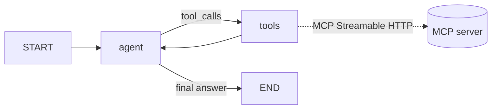

# Architecture

## Components

| Module | Responsibility |
|---|---|
| `app/mcp_server/` | MCP Python SDK v2 `MCPServer` with the five tools, typed input/output schemas, annotations, bearer-token verification (`TokenVerifier`), Host/Origin protection, Streamable HTTP (stateless, JSON responses). `__main__` runs it standalone. |
| `app/agent/` | `mcp_client.py` discovers tools with LangChain's `langchain.mcp.MCPAdapter` (FastMCP client, Streamable HTTP). `graph.py` is the LangGraph `StateGraph`. `grounding.py` checks citations after each answer. |
| `app/api/` | FastAPI routes, auth, upload validation, and response shaping (trace, citations, tables, report links). |
| `app/rag/` | `pdf.py` does page-aware extraction and chunking. `embeddings.py` chooses the embedding provider. `store.py` handles Chroma ingestion, de-duplication and retrieval. |
| `app/services/` | arXiv client, GitHub analyzer, experiment statistics, report builder, and the outbound HTTP allow-list. |
| `app/core/` | Settings (pydantic-settings), security helpers, and log redaction. |
| `frontend/` | Dependency-free HTML/CSS/JS UI served by FastAPI. |

## Request flow (chat)

1. `POST /api/chat` is checked for the API key in middleware, then rate limited and validated with pydantic.
2. `ResearchAgent.run` invokes the compiled graph with `thread_id` (checkpointer memory), a recursion limit, and
   an overall `asyncio.timeout`.
3. The **agent node** calls the chat model with the system prompt and the windowed, repaired history. The tools
   come from MCP discovery and are bound only while budget remains.
4. If the model emitted tool calls, the **tools node** executes them concurrently. Each call is a LangChain tool
   produced by `MCPAdapter`, which sends `tools/call` over Streamable HTTP to the MCP server. Each call has its
   own timeout. Unknown tools, MCP `isError` results, transport errors and timeouts become error `ToolMessage`s
   rather than exceptions, so the model can recover. Calls beyond `AGENT_MAX_TOOL_CALLS` are marked `skipped`.
   Every call adds a trace entry (`tool`, `status`, `duration_ms`, `arguments`, `error`).
5. The loop returns to the agent node until the model answers without tool calls. Once the budget is spent, the
   model is called without tools and told to answer with the evidence it has.
6. The API extracts structured tool results (MCP `structuredContent`, carried as the ToolMessage artifact) into
   citations, experiment tables and report links. `check_citations` then verifies every document page, arXiv ID,
   GitHub repository and report link in the answer against tool results from the thread. Unverified ones are
   listed and flagged in the answer.

## Why the report tool re-fetches evidence

`generate_report` accepts only *pointers*: arXiv IDs or a query, a document question, a repository name and
experiment file names. It never accepts facts. It re-fetches each source itself, so every paper title, quotation
and number in the report comes from arXiv, Chroma, GitHub or pandas, never from model output. The only
model-written text allowed is `interpretation`. That text goes in a labeled section, and any URL or arXiv ID in
it that is not among the report's references is removed.

## Experiment statistics

- Runs are identified by (`source_file`, group column, experiment id, seed, dataset), using whichever exist.
- A run's *final* value is the metric at its maximum epoch (or its last row when there is no epoch column).
- Per group: mean and sample standard deviation (ddof = 1) of final values across runs, plus the best value
  observed at any epoch (min or max by direction).
- Direction: metrics matching loss/error/mse/mae/rmse/perplexity/latency/time/… are lower-is-better; everything
  else is higher-is-better. `metric_directions` overrides this.
- Improvement vs. baseline is `(v − b)/|b|·100` for higher-is-better and `(b − v)/|b|·100` for lower-is-better,
  so a positive number always means better.

## Version notes (verified Oct 2026)

| Package | Version | Note |
|---|---|---|
| `mcp` | 2.3.0 | v2 API: `from mcp.server.mcpserver import MCPServer` (v1's `FastMCP` import is gone) |
| `langchain` | 1.4.7 | with the `mcp` extra, `langchain.mcp.MCPAdapter` is the current official MCP integration (beta) |
| `fastmcp` | 4.1.4 | client used by `langchain.mcp`, compatible with MCP SDK v2 |
| `langgraph` | 1.2.18 | |
| `chromadb` | 1.5.9 | client and the `chromadb/chroma:1.5.9` server image |

`langchain-mcp-adapters` 0.3.2 pins `mcp<2`, which is why this project uses `langchain.mcp` instead.
